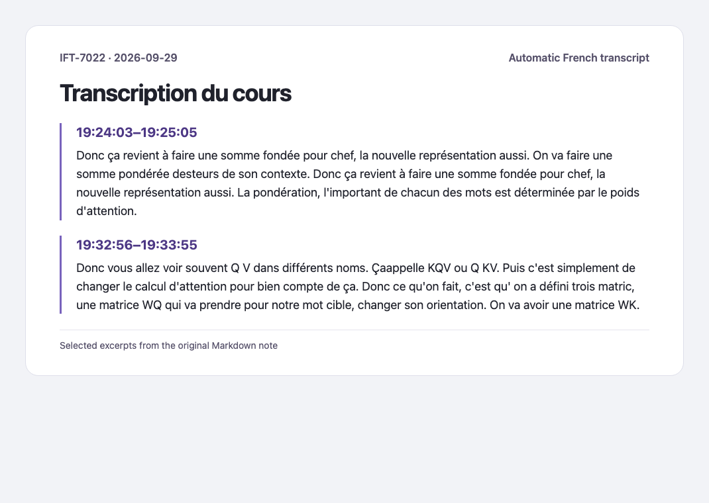
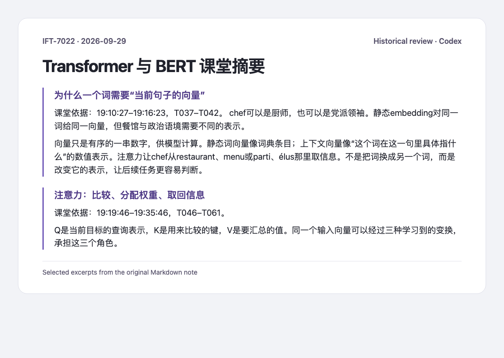

# Leo Lecture Assistant

A native macOS study assistant for French-language lectures. Capture a microphone or a specific app, follow bilingual captions, and save a timestamped transcript and revision notes in Obsidian. A Python CLI answers questions across course notes with source citations.

## How it works

```mermaid
flowchart LR
    audio["App audio or microphone"] --> live["Gemini Live"]
    audio --> apple["Apple Speech"]
    live -.->|"Auth, quota, or network failure"| apple
    live --> finals["Final French transcript"]
    apple --> finals
    finals --> journal["Local recovery journal"]
    journal --> dedupe["Deduplicate and group by timestamp"]
    dedupe --> obsidian["Obsidian Markdown"]
    dedupe --> bookmark["90-second confusion bookmark"]
    bookmark --> obsidian
    dedupe --> review["Gemini review on Finish"]
    bookmark --> review
    review -->|"Bilingual outline, concepts, explanations"| obsidian
    obsidian --> rag["Python RAG with Gemini embeddings and FAISS"]
    rag --> citations["Answer with date, time, and source excerpt"]
```



On **Finish**, the app saves the French transcript before requesting one structured Gemini response. The request includes the full deduplicated session, course glossary, and saved bookmark context. Gemini writes a bilingual outline and concept summary, plus an accessible Chinese explanation for each bookmark with French terminology. The app appends the review to the daily Lecture note and shows whether it succeeded. The raw transcript is available for review if the request fails.

## Real class example

Selected, redacted excerpts from IFT-7022 on September 29, 2026. The transcript was produced by the app during class. The historical review shown here was prepared separately by Codex from that transcript and labeled accordingly.

| Timestamped French transcript | Historical course review |
| --- | --- |
|  |  |

## Run the macOS app

1. On macOS 26 with Xcode 26 or newer, run `./scripts/install-local.sh` from a clone. It builds, signs locally, and installs the app in `~/Applications`.
2. Open Settings and select a compatible Obsidian vault and course. The [sample configuration](Config/leo-config.example.json) shows the course paths. The vault requires `AGENTS.md`, `Home.md`, `10_Courses/`, `20_Concepts/`, and `50_Maps/`. Each configured course folder must exist.
3. Pick an audio source and grant the requested macOS permissions. Use **Apple Local** by default. To add a Gemini review while keeping Apple transcription, enable **Generate a Gemini review after Apple Local classes** in Settings. **Gemini Smart** also uses Gemini during capture. Either cloud mode requires a Gemini API key in Keychain and confirmation that the Google project has billing disabled.
4. Start the class, use **没听懂** to bookmark confusing moments, and click **Finish**. Open the result with **Open in Obsidian**.

Cloud review sends the current session transcript, glossary, and bookmark excerpts to Google's Gemini API. See [privacy and cost](docs/privacy.md) and [Obsidian integration](docs/obsidian-integration.md).

## Ask questions across lectures

The [Python course Q&A CLI](rag-study-assistant/README.md) indexes dated notes and timestamped transcripts. Ask in Chinese or French and trace the answer to the exact Markdown excerpt. The index and the original course notes stay outside the repository.

## Development

```sh
swift test
xcodebuild -project v2s.xcodeproj -scheme v2s -configuration Debug CODE_SIGNING_ALLOWED=NO build
```

The test suite exercises local persistence, deduplication, recovery, and the review lifecycle. An opt-in integration test checks the actual Gemini response with a synthetic French lecture. See [testing](docs/testing.md) and [architecture](docs/architecture.md).

## Attribution

This project builds on [franklioxygen/v2s](https://github.com/franklioxygen/v2s) for Core Audio capture, Apple Speech and Translation, and the subtitle overlay. [ATTRIBUTION.md](ATTRIBUTION.md) details the five portfolio contributions, the upstream MIT statement, and third-party notices. The original upstream instructions are preserved in [README.upstream.md](README.upstream.md).
